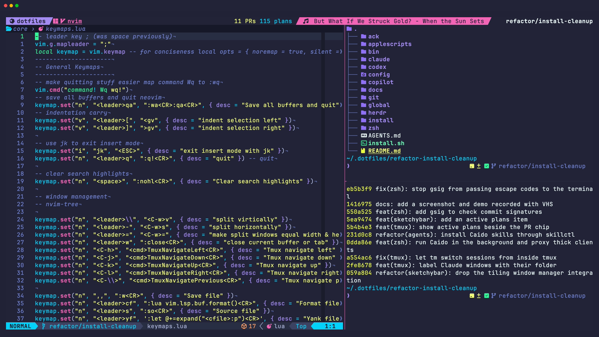
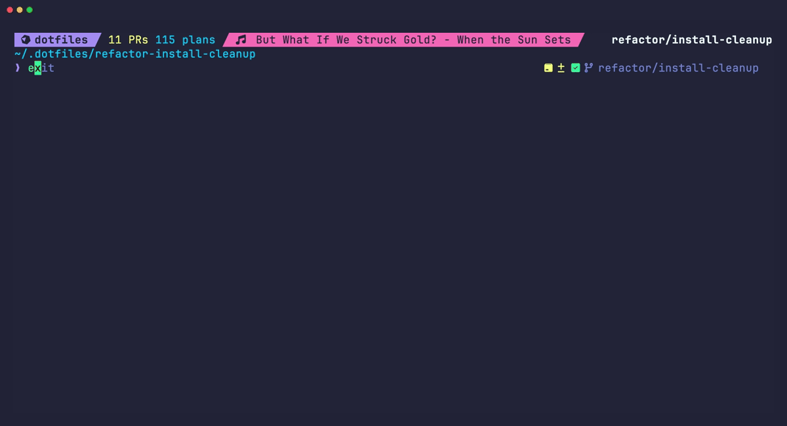

# Dotfiles

Personal macOS development configuration for Zsh, Neovim, tmux, Ghostty, Git, and AI coding tools. Installation is split into scripts under `install/`; application settings live under `config/`.





## Installation

On a new machine, nothing needs to be set up first. The repository is cloned bare with one worktree per branch, the same layout `bin/git-bare-clone` creates. That script is not on `PATH` yet, so clone by hand:

```sh
mkdir -p ~/.dotfiles && cd ~/.dotfiles
git clone --bare https://github.com/hacker1db/Dotfiles.git .bare
echo "gitdir: ./.bare" > .git
git --git-dir=.bare config remote.origin.fetch "+refs/heads/*:refs/remotes/origin/*"
git --git-dir=.bare fetch origin
git --git-dir=.bare worktree add main main
git -C main branch --set-upstream-to=origin/main
cd main
./install.sh all
```

The first clone uses HTTPS because 1Password and its SSH agent are not installed yet; the repository is public, so it needs no credentials. Once `install.sh` links `~/.gitconfig`, its `insteadOf` rule sends GitHub traffic over SSH, so later fetches and pushes in `~/.dotfiles` go through 1Password like any other repository. The installed links always point at `~/.dotfiles/main`, and branch worktrees (`wt switch -c <branch>`) land beside it in `~/.dotfiles/`.

Each step under `install/` is one zsh script with the same name; `install.sh` runs them in order. The scripts change macOS preferences and configure applications, so review them before a full run.

To try the configuration from a different worktree, select it explicitly:

```zsh
cd ~/.dotfiles/refactor-install-cleanup
./install.sh use ~/.dotfiles/refactor-install-cleanup
```

`use` retargets existing configuration symlinks from the active checkout to the selected checkout, then opens a fresh Zsh automatically when run in a terminal. It preserves unmanaged files, checks replacement paths before changing links, and runs no package installs. Zsh derives `DOTFILES` from its selected configuration file. Other existing terminals need to reload; applications load the selected configuration when they next reload or restart. This selection applies across terminals. Keep the selected worktree until you switch away from it. Noninteractive invocations only update the links.

From the selected feature shell, switch back with:

```zsh
cd ~/.dotfiles/main
dotfiles-use
```

`dotfiles-use [checkout]` accepts an explicit path or defaults to the current directory. `./install.sh use` defaults to the worktree containing that installer.

Homebrew 7 asks for confirmation before installing or upgrading packages. `HOMEBREW_NO_ASK=1` turns this off: `install/tools.zsh` sets it for the install, and `zsh/brew.zsh` exports it for interactive shells, so neither stops at `[y/n]` prompts. Bundle applies the trust declarations in `install/brewfile`. Remove the export from `zsh/brew.zsh` to get the prompts back.

| Command | Purpose |
| --- | --- |
| `./install.sh tools` | Install Homebrew, the tools declared in `install/brewfile` (removing undeclared Homebrew and App Store packages), and developer tools; finish with the deferred installs and `chsh` |
| `./install.sh link` | Link configuration into `$HOME`, clone clitools and plan-manager, configure the Git identity and signing key, and install the Go `plan` CLI |
| `./install.sh node` | Install pnpm global tools; run Readwise and Codex Security login setup |
| `./install.sh dotnet` | Install .NET SDKs, runtimes, and global tools |
| `./install.sh osx` | Apply macOS preferences, create standard folders, and install NvimTmux.app with `duti` associations |
| `./install.sh theme list` | List theme candidates (`apply <name>`, `current`, and `sync` also work) |
| `./install.sh tmux-plugins` | Bootstrap TPM at `~/.local/share/tmux/plugins/tpm` |
| `./install.sh agent-profiles` | Generate and link the Claude Code profiles and the Codex Foundry home (`--check`, `--skip-foundry`) |
| `./install.sh deferred` | Finish the Brewfile installation and cleanup that were skipped because they need a password, then `chsh` |

`all` runs tools, link, node, dotnet, osx, theme, browser, tmux-plugins, and agent-profiles, in that order, then the deferred installs and shell change. Linking runs after the tools so `~/.gitconfig` (its GitHub-over-SSH settings need the 1Password agent) and the clitools and plan-manager clones work on the first pass. Steps that ask for your macOS password (casks that need `sudo`, Mac App Store installs, and `chsh`) are moved to the end; see [install password prompts](docs/install-password-prompts.md). Individual steps can be rerun, but package updates, authentication, and generated settings are not no-op operations.

`DOTFILES_NONINTERACTIVE=1 ./install.sh link` suppresses the Git identity and signing-key prompts; it does not suppress every authentication prompt.

### Homebrew tools

`install/brewfile` is the source of truth for Homebrew formulas, casks, taps, and Mac App Store apps. `./install.sh tools` uses Bundle directly:

```zsh
brew bundle install --file=install/brewfile
brew bundle cleanup --file=install/brewfile --brews --cask --tap --mas --force
```

Cleanup runs only after installation succeeds. During `./install.sh all`, the deferred pass finishes Bundle installation before cleanup. Removal is scoped to the same package types captured in the Brewfile; separately installed npm/pnpm globals, Go tools, and native installers are not removed.

`brew-cleanup` keeps its original capture behavior: dump installed packages into the Brewfile, validate the formula list, replace the file, then run `brew cleanup` and `brew doctor`. It records this machine's inventory, so review the diff before committing; declarations for tools absent from this machine may disappear. `brew doctor` warnings can return a failure after capture succeeded.

To retire a tool, remove its Brewfile declaration and run the installer on each machine. Do not run capture first, because it would record the still-installed tool again. To preview removal without accepting prompts, run `brew bundle cleanup --file=install/brewfile --brews --cask --tap --mas < /dev/null`.

## Shell and terminal workflow

- Zsh loads `zsh/**/*.zsh`, autoloads `zsh/functions/`, and reads `~/.localrc` for local overrides.
- Starship supplies the prompt; zoxide provides `cd`; eza provides `l` and `ll`.
- `r!` and `reload!` source `~/.zshrc` in the current shell. If a Homebrew upgrade removed that shell's module directory, `.zshrc` starts fresh Zsh to restore completion support.
- fzf-tab uses zfetch; completion includes kubectl, 1Password, sesh, and skillctl. fnm selects Node versions when entering directories with Node project markers.
- Plan completion uses native Zsh output when supported and falls back to Bash completion through the initialized `bashcompinit` for older CLI installations.
- `daily` opens a dated SecondBrain note, `yy` changes directory through Yazi, `ts` and Alt+s select sesh sessions, and `gh-rate-limit` inspects GitHub limits.
- Ghostty uses `config/ghostty/config`: JetBrains Mono italic at 14pt, 78% opacity, blur, linkarzu colors, and clipboard copy-on-select. The old WezTerm configuration has been removed.
- tmux lives in `config/tmux/tmux.conf`, uses Ctrl+a as its prefix, and includes vi copy mode, mouse support, undercurl colors, session persistence through resurrect/continuum, and Neovim pane navigation. Prefix+o opens sesh; prefix+g opens lazygit; prefix+G opens gh-dash; prefix+O opens the fleet dashboard popup; prefix+u uses the fzf URL picker. `tm` lists sessions or creates one (`tm <name>`); inside tmux it switches the current client instead of nesting.
- ai-usage reads `config/ai-usage/projects.yaml`, linked at `~/.config/ai-usage/`, for its ownership rules and dashboard profile filters (`profiles:`). By default GitHub user-owned repos are labeled personal and org-owned repos org; the file holds exceptions.
- `./install.sh tmux-plugins` bootstraps TPM at `~/.local/share/tmux/plugins/tpm`, copying an existing plugin directory from a dotfiles worktree when available and otherwise cloning over SSH. Plugin storage is shared across worktrees. Incomplete installations fail with a diagnostic. Reload tmux, then press Ctrl+a followed by Shift+i to install configured plugins.
- `tmux-reload-all` reloads the server configuration, refreshes attached clients, and starts a fresh Zsh in the current terminal. Run it once in each affected shell after a Homebrew Zsh upgrade; other panes keep their running programs. Reloading configuration alone cannot restore module files removed from an older Zsh installation.

### Worktrunk and Git worktrees

`wt` shell integration is loaded from Zsh. User settings are in [config/worktrunk/config.toml](config/worktrunk/config.toml), linked at `~/.config/worktrunk/config.toml`. Worktrees use sibling directories named after sanitized branches; switching in tmux renames the window. Commit generation calls the configured `ocr` command, which must be available separately.

```sh
wt switch --create feature/my-change
wt pull-all
```

`wt pull-all` fetches every remote with pruning, then runs `git pull --ff-only --no-autostash` in each worktree **of the current repository** using that branch's configured upstream. Worktrees without a resolvable upstream, including detached worktrees, are skipped. A failed initial fetch stops the operation; individual pull failures are reported while remaining worktrees continue. Diverged branches require manual resolution. Local edits are not stashed; Git refuses updates that would overwrite them. This does not discover unrelated repositories or change remote URLs.

`wt-pull-all` in `zsh/functions.zsh` is the fuller sync. It fetches all remotes with pruning, runs `wt switch --no-cd --no-hooks` for every remote branch of `origin` that has no worktree yet and is not already merged into the default branch, fast-forwards every worktree the same way the alias does, and then confirms the local default branch matches its upstream. When the default branch is not checked out anywhere it is fast-forwarded as a plain ref, so the primary worktree can stay on a feature branch. A default branch that is behind or diverged is reported and makes the command exit non-zero. Finally `wt step prune --foreground` removes worktrees and branches already merged into the default branch, keeping Worktrunk's one-day age guard for fresh worktrees. `wt-pull-all --dry-run` prints the worktrees it would add and previews the prune without changing anything. Reload it with `source ~/.dotfiles/main/zsh/functions.zsh`. `cob` wraps `wt switch --create`; `git-bare-clone` supports cloning, `--init`, and `--fix` for a `.bare` repository with linked worktrees. Run `git-bare-clone --help` for its arguments. `gcc` invokes `git-clean-merged`, which can delete merged local **and remote** branches.

## Neovim

Configuration: `config/nvim/`. lazy.nvim imports the `extra`, `git`, `ui`, `lsp`, and `mini` plugin directories.

| Area | Current configuration |
| --- | --- |
| Completion | blink.cmp, LuaSnip, Copilot completion integration |
| LSP | mason.nvim, lspconfig, lspsaga; TypeScript tools, gopls, Lua, Python, Terraform, Docker, YAML, JSON, markdown-oxide, and harper-ls |
| Formatting/linting | conform.nvim and nvim-lint |
| Navigation/UI | Snacks explorer, picker, dashboard, notifier, indent, terminal, and zen; lualine, noice, which-key, trouble |
| Git | Fugitive, Gitsigns, Neogit, Octo; Telescope Git pickers and Snacks Git views |
| Editing | mini.ai, mini.comment, mini.icons, mini.pairs, mini.surround; Treesitter context, textobjects, and autotag |
| Markdown | Obsidian integration, render-markdown, heading capitalization, filetype-specific folds, `.svx` Markdown detection, and vault-backed LuaSnip templates |
| AI/testing/debugging | Copilot, CopilotChat, vim-test, and DAP configuration |
| Colors | Eldritch and custom diagnostic/heading highlights |

Space is the leader. Use `<leader>e` for the explorer, `<leader>ff` for files, `<leader>fr` for recent files, `<leader>/` for grep, `<leader>,` for buffers, and `<leader>sh` for help. `gd`/`gr` navigate LSP definitions/references. See `lua/core/keymaps.lua` and plugin `keys` tables for the complete mappings; some Git mappings are defined in both places.

The former nvim-cmp and nvim-tree configurations are removed. mini.files, mini.pick, and Avante are not configured. [Mini plugin notes](config/nvim/lua/plugins/mini/mini.md) describe the active modules. Standalone specs for mini.bracketed, mini.diff, and undotree remain directly under `lua/plugins/`, outside the imported directories; their presence and related keymaps do not establish that they load.

```sh
nvim +checkhealth
nvim --headless "+Lazy! sync" +qa
```

Plugin sync installs/updates plugins and can modify `lazy-lock.json`; it is not a read-only check. Obsidian and snippet configuration assumes a personal SecondBrain vault; adjust those paths for another machine.

## Git identities and hooks

Each machine uses one GitHub user exclusively. `git/gitconfig.symlink` provides account-neutral defaults, `hunk pager`, Delta for interactive diffs, and fast-forward-only pulls; the machine's `user.name`, `user.email`, `github.user`, `user.signingkey`, and `gpg.ssh.program` live in the untracked `~/.gitconfig-local`, which `~/.gitconfig` includes last so it overrides the tracked defaults. `./install.sh link` prompts for each one, offering the current value as the default, and enables commit and tag signing once a signing key is set. Signing uses SSH: the signing key is the public key of an SSH item in your password manager, and its agent signs, so no private key file is written. Dotfiles does not manage `~/.ssh/config` or `~/.config/1Password/ssh/agent.toml`; each machine owns them. `./install.sh link` also asks for the 1Password item and vault of the machine's GitHub SSH key and lists it first in `agent.toml`, because 1Password offers keys in that order and GitHub signs in with the first one it recognizes; other entries are kept, and the file can be edited directly afterwards. On a machine where that file is still linked into a checkout, run fleet-manager's `fleet op-agent` first. Let 1Password's SSH agent setup add its `IdentityAgent` block, and add host aliases there.

SSH connections do not reserve development ports automatically. Using host aliases from the machine's `~/.ssh/config`, open a tunnel only for the service you need, choosing an unused local port:

```sh
ssh -N -o ExitOnForwardFailure=yes -L 127.0.0.1:13000:127.0.0.1:3000 stronghold
ssh -N -o ExitOnForwardFailure=yes -L 127.0.0.1:23000:127.0.0.1:3000 aiserver
```

These expose each machine's port 3000 at `http://127.0.0.1:13000` and `http://127.0.0.1:23000`, while local port 3000 remains available. Choose another local port if one is occupied. Stop a tunnel with Ctrl+c. Existing SSH sessions retain their forwards until disconnected; remove any duplicate automatic `LocalForward` entries from `~/.ssh/config` as well.


New repositories can inherit `git/templates/hooks/` through `~/.git-templates`, which `install.sh link` creates and `install.sh use` repoints at the selected checkout. The dispatcher resolves `git/hooks/` from the checkout `~/.gitconfig` links to, falling back to `~/.dotfiles/main`. Git copies template hooks only at clone time, so `install.sh link` also replaces stale dispatcher copies in existing repositories under `~/Developer` (override with colon-separated `DOTFILES_HOOK_ROOTS`). It runs matching files there and propagates failures: JSCS/JSHint pre-commit checks, recent-branch tracking after checkout/merge, and a GitGuardian (`ggshield`, installed by the Brewfile) secret scan of staged changes. The GitGuardian hook runs only for repos whose `origin` is a personal owner (`hacker1db`, `zerobitconsulting`, or the `github-hacker1db`/`hb1` SSH aliases; override with `GITGUARDIAN_PERSONAL_REMOTES`) and skips every other repo, including work remotes. It uses only your personal token, read with `op read` from the 1Password Automation vault (`op://Automation/GG Scan Token/credential`; override with `GITGUARDIAN_PERSONAL_OP_REF`) through the service account in `OP_SERVICE_ACCOUNT_TOKEN` (exported by `~/.localrc`), the same way fleet-manager's `fleet-git` gets its keys. It never uses the desktop app or a work login, so it works headless and from agents. It blocks the commit when it finds a secret, when the token or service account is missing or invalid, or when `ggshield` or `op` is not installed. Any work scanning hooks are configured machine-locally, outside this repository.

## CI and security scanning

`.github/workflows/ci.yml` runs on pushes to `main` and on pull requests: `zsh -n` over `install.sh`, `install/*.zsh`, and the Zsh configuration, plus Luacheck over the Neovim config (ignoring existing unused-variable and line-length warnings). A `secrets` job scans the full history with TruffleHog, pinned to a commit SHA, and fails on any finding, verified or unverified; false alarms get an exclude file reviewed in the PR. On pull requests, dependency review fails if a change adds a dependency with a known vulnerability of any severity.

`.github/workflows/codeql.yml` runs CodeQL `security-extended` queries for GitHub Actions and JavaScript/TypeScript on pushes to `main`, on pull requests, and weekly. `.github/dependabot.yml` opens update pull requests for npm, NuGet, Docker, and pinned GitHub Actions. Every action is pinned to a commit SHA.

## AI tools and shared instructions

| Tool | Source | Installed instruction file |
| --- | --- | --- |
| Claude Code | `claude/CLAUDE.md` | `~/.claude-{personal,subscription,foundry}/CLAUDE.md` |
| Codex | `codex/AGENTS.md` → `global/AGENTS.md` | `~/.codex/AGENTS.md` |
| Copilot CLI | `config/copilot/copilot-instructions.md` → `global/AGENTS.md` | `~/.copilot/copilot-instructions.md` |

Edit root `AGENTS.md` for repository guidance and `global/AGENTS.md` for the single shared policy. `claude/CLAUDE.md` and the other tool instruction sources are symlinks to it. `./install.sh link` installs the instruction links with backups. Start a new tool session to reload them.

Claude installation links instructions, output styles, and the statusline script into each profile directory, and generates each profile's settings from layered fragments. MCP configuration is linked to `~/.mcp.json`.

- [Claude profiles](claude/PROFILES.md): `cc` (personal, the default), `cw` (work subscription), and `cf` (Foundry) each use their own `CLAUDE_CONFIG_DIR` with separate login, settings, skills, and plugins. `./install.sh agent-profiles` generates and installs all three.
- [Codex profiles](codex/PROFILES.md): `xp` (personal, `~/.codex`) and `xf` (Foundry, `~/.codex-foundry`) use separate `CODEX_HOME` directories, so the Foundry profile never sees the personal ChatGPT login. The same `./install.sh agent-profiles` step generates and links the Foundry home.
- Workflow slash commands (reviews, GitHub/Azure DevOps, security, notes, reading, writing) come from the skills repository through skillctl, not from command files here. GitGuardian runs as a Git hook, not a Claude hook.

### Fleet agent orchestration

Agent sessions across Claude Code, Codex, and Copilot are monitored with [Fleet](https://github.com/nicknisi/fleet), Nick Nisi's tmux agent dashboard, installed from his `nicknisi/formulae` Homebrew tap via the Brewfile. The tmux keybindings and sketchybar wiring here (`bin/sketchybar-fleet-watch`, the fleet block in `config/tmux/tmux.conf`) are adapted from [nicknisi/dotfiles](https://github.com/nicknisi/dotfiles) (MIT). `./install.sh agent-profiles` wires the fleet hooks into each Claude profile and Codex; Copilot is tracked by process discovery. See [Fleet integration](docs/fleet.md).

### Herdr

[Herdr](https://herdr.dev) is installed by `./install.sh tools` with its own installer. `./install.sh link` links the `herdr/` key map, layout, theme, and mods into `~/.config/herdr-app` one by one, since Herdr writes its own files there too. The `dotfiles` layout adds a tmux-style `ctrl-a` prefix, a status bar with the playing song, agent counts, review requests, and active plans, panels for pull requests and plans, a new-branch dialog that creates a Worktrunk worktree and copies ignored `.env` files with `bin/wt-new`, and a Fleet panel. See [Herdr integration](docs/herdr.md).

### Personal skills

Personal skill sources live in [hacker1db/skills](https://github.com/hacker1db/skills). `bin/skillctl` resolves a normal checkout at `~/Developer/skills` or its `main/` worktree, rebuilds the Go CLI for normal invocations, and reuses the last build for completion. Set `SKILLCTL_REPO_DIR` for another checkout. Follow that repository's README for selections and installation.

Dotfiles holds no personal skills; they come from the skills repository through skillctl, which the profile installer runs for each Claude profile. Caido Mode uses the same catalog and installation workflow once the skills checkout includes it.

```zsh
skillctl --repo /path/to/project add caido-mode
```

### Plan-manager integration

[Plan-manager setup and troubleshooting](docs/plan-manager.md) documents the separate application checkout and `~/.local/bin/plan`. Dotfiles policy uses `~/notes/SecondBrain/4.Resources/plans` as the canonical library and the hosted site as its dashboard; `plan serve` still runs the local dashboard by hand. `./install.sh link` clones or fast-forwards the checkout, runs `go install ./cmd/plan` from its `cli` module into `~/.local/bin`, and checks that Codex can write to the plan library; application source and plan data are not stored here. Publishing requires an explicit request.

## Symlinks and themes

`*.symlink` sources map into `$HOME` with a leading dot; `config/*` maps into `~/.config/`. The general loops skip existing targets. Managed instruction links and selected integrations have their own replacement/backup behavior. `~/.gitconfig-local` is always a machine-owned file: an older link to a shared copy is replaced with a local copy of it. `link` may clone or fast-forward clitools and plan-manager and rebuild the `plan` CLI. Before cloning, it looks for an existing checkout of either repository under `~/Developer/<name>` or `~/Developer/*/<name>` whose `origin` matches, and uses it instead. clitools is a private repository: when it cannot be reached, the clone is skipped. plan-manager is public; a fork without its own plan-manager clones `hacker1db/plan-manager`.

```sh
./install.sh theme list
./install.sh theme apply eldritch
./install.sh theme current
./install.sh theme sync
```

The theme script writes Neovim, Starship, Ghostty, and tmux settings. Candidate names come from the terminal/tmux theme files; a listed name does not guarantee a matching theme for every application. These operations can modify tracked configuration.

## Validation

```sh
for f in install.sh install/*.zsh; do zsh -n "$f" || exit 1; done
zsh -n zsh/zshrc.symlink
zsh -n zsh/functions.zsh
zsh install/agent-profiles.zsh --check
git diff --check
```

Linking can be rehearsed in a throwaway home with `HOME=$(mktemp -d) DOTFILES=$PWD zsh install/link.zsh` (links target `~/.dotfiles/main` unless `DOTFILES` says otherwise). These checks do not prove a complete fresh-machine install, live provider authentication, or interactive Neovim/tmux behavior. No credentials should be committed; use local configuration and the configured credential providers. CI runs the same `zsh -n` loops plus TruffleHog, which fails on any finding.

## Screenshots

`docs/screenshot.png` and `docs/demo.gif` are recorded with [VHS](https://github.com/charmbracelet/vhs) (`brew install vhs`), which is not in the Brewfile. Regenerate them from the worktree root:

```zsh
vhs docs/screenshot.tape
vhs docs/demo.tape
```

The tapes need `tmux`, `nvim`, `eza`, `bat`, and the JetBrainsMono Nerd Font. Both record the current checkout, so the branch name and recent commits appear in the output; record from `main` for the published images.
